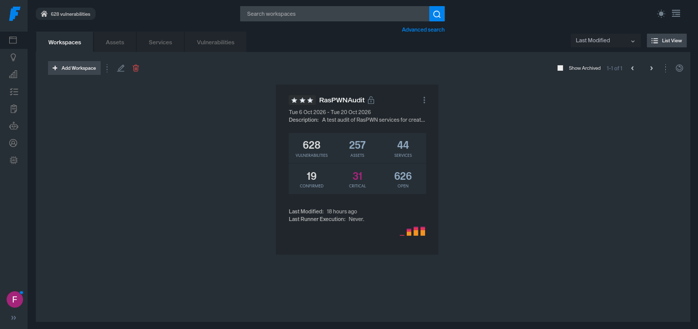
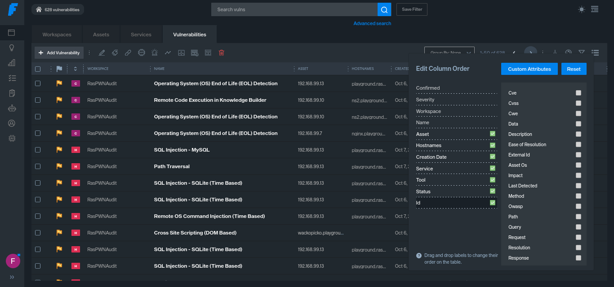
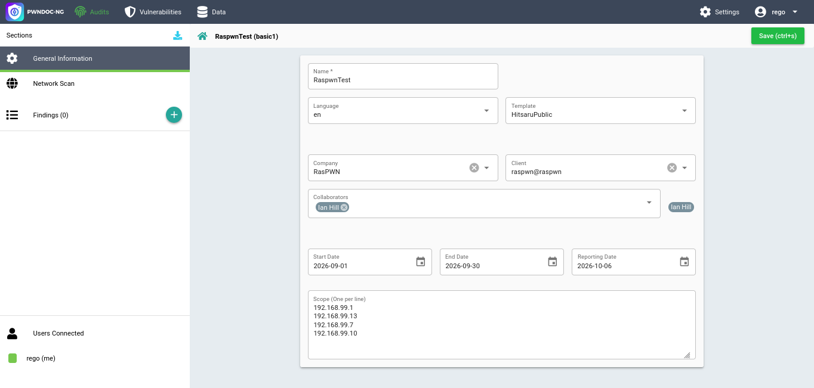
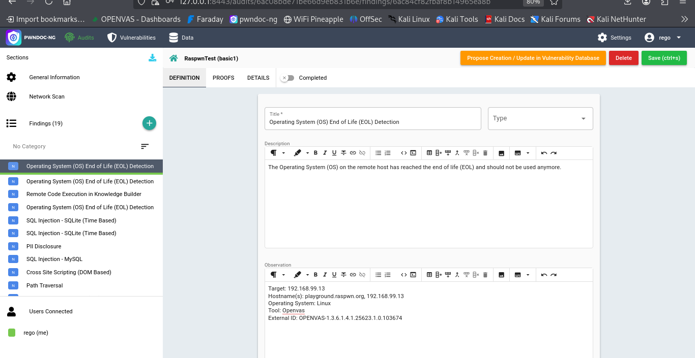
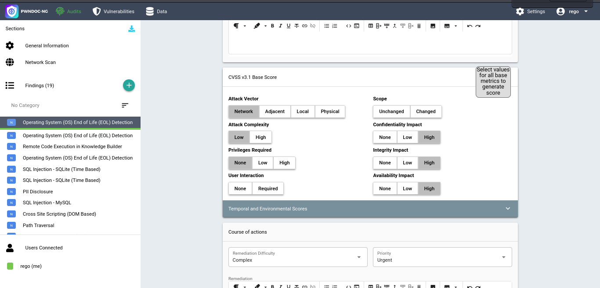
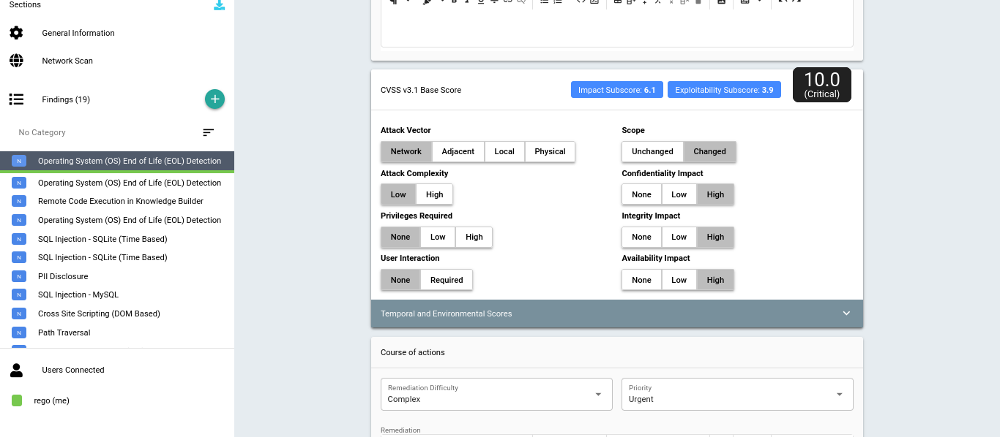

# FaradayCEtoPWNDOCNG Report Generator
Ian Hill, 2026

This program is FREEWARE and released with NO WARRANTY.

Is an Python API based script tool to allow users to transform vulnerability data from the FARADAY CE API to a PWNDOC-NG API into audit report findings.
This allows a user to aggregate vulerability scanning tools, triage findings, and manage workflows with FARADAY CE and effectively translate
those findings into an external FOSS report generation tool with customizable template capability.

Included is a sample csv output from faraday ce and a sample generated report exported in PDF format.

The target for this test was a local RASPWN OS self hosted pentesting platform. Testing of the source target is intentionally not
extensive as this project is intended for displaying the report generation capability, not pentesting. Minimal formatting and editing
was done to the generated report to showcase the output, but the default template was modified to produce a custom template for this
demonstration.

### Workflow:

- Install and have functional instances of both Faraday CE and PWNDOC-NG.
- Edit credentials.py.SAMPLE to credentials.py and populate with real credentials.
- Create a Faraday Project.
- Import your vulnerability scans and findings into FaradayCE.

- Update the necessary feilds such as complexity, impact, and http request/header fields.

`	NOTE: Evidence fields such as image files in faraday will not translate through API calls. You will need to add these manually in the PWNDOC-NG 'proofs' section `

`	NOTE: only CONFIRMED items that are FLAGGED will be sent to PWNDOC-NG documentation `

- Select the filters to include 'id' in the LAST position, as the CSV parser will use the last CSV field to lookup vuln findings in the Faraday API.

- Create the appropriate Audit in PWNDOC-NG to recieve the data from Faraday.

- Run the FaradayCEtoPWNDOC-ng-ReportGenerator.py script and observe the import of findings to your pwndoc-ng report, confirm import.

- Triage the report information by confirming CVSS scoring and completing any necessary fields to render the vulnerability in the docx report.

- SAVE changes before moving to each new finding.
- Download the report from pwndoc-ng.
